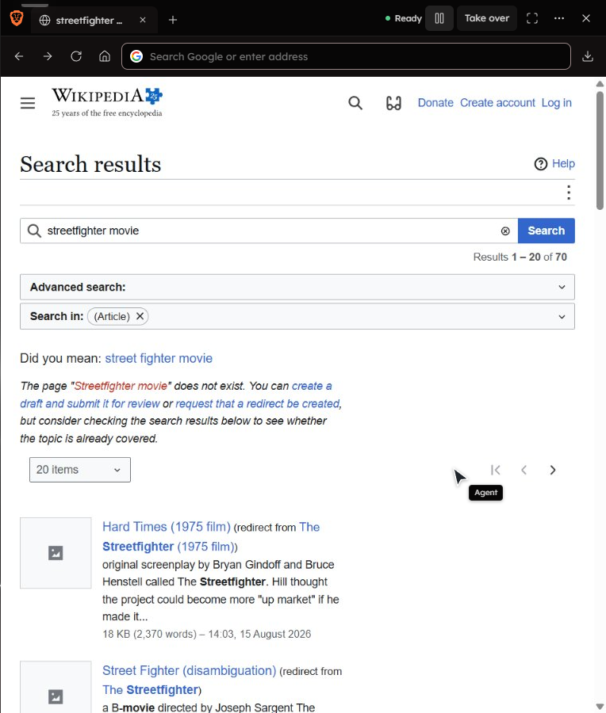

# Browser settings and agent controls: publication verification

This PR is assembled from the browser work in the shared checkout onto
`origin/main` at `6396efc`. It extends merged PRs #214 and #217 rather than
reintroducing their commits. Unrelated voice, creator-feed, calendar, X,
personalization and appearance changes are excluded.

## Exact isolated PR checks

- Browser agent, chat-flow, cursor, viewport, preferences, settings, lifecycle,
  suggestions and conversation App Action suites: **170 passed, 1 skipped**.
- Focused API/capability and mid-turn graph-repair checks: **2 passed**.
- First frontend run: **375 passed, 2 failed**. Both failures extracted the old
  inline browser-opening callback. They were updated to exercise the shared
  `openBrowser` handler, including cancellation during pending startup.
- Focused browser-opening and Action Parity rerun after those updates:
  **19 passed**, with a 15-second parser allowance. The repeat full run hit a
  five-second parity timeout and Windows fork-worker termination delays. The
  377 frontend cases are covered across the full and focused checks; a clean
  single-run completion is not claimed.
- Production frontend build and scoped whitespace checks passed.
- The full backend suite was not run. A broader API run was stopped during
  resource contention; only the focused API result above is claimed.

Action Parity includes the new Browser settings source, its mutation controls,
the cursor settings and the workspace divider. Existing unrelated controls and
their inventory entries are preserved.

## Earlier live evidence

These checks ran before publication isolation, in muted disposable Brave
profiles with separate test storage. They are evidence for those flows, not
a new end-to-end run of the isolated PR branch:

- A real Gemma 4 12B chat request opened Wikipedia, entered the movie query and
  submitted it. The actual served panel opened without a sidebar click and
  displayed 13 rendered cursor positions in 45.3 seconds. The run exposed the
  subsequent resize/planning fix; the time is not a post-fix speed measurement.
- Chat reported Google, changed to DuckDuckGo, and read DuckDuckGo back without
  launching Brave. The restarted working API separately read its actual saved
  engine without changing preferences or opening the browser.

## Scope and limits

Settings manage the owned Brave profiles, not an everyday browser's profile.
The web UI still streams pixels; native embedding and its build prerequisites
remain deferred. Custom Cursor installation, extensions, WebMCP, annotation
screenshots and a native Save As dialog are not integrated. Site permission
changes can require reopening the profile. No claim is made about every site,
long-running signed-in browsing, prolonged video playback or CAPTCHA behavior.
No profile directories, cookies, credentials, runtime history or test logs are
included in the commit.
