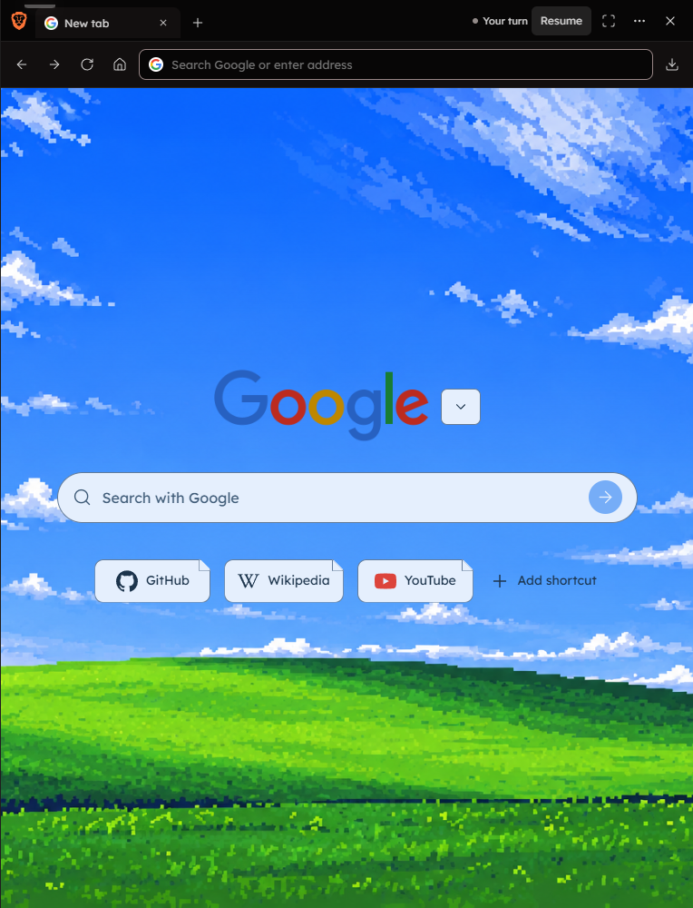
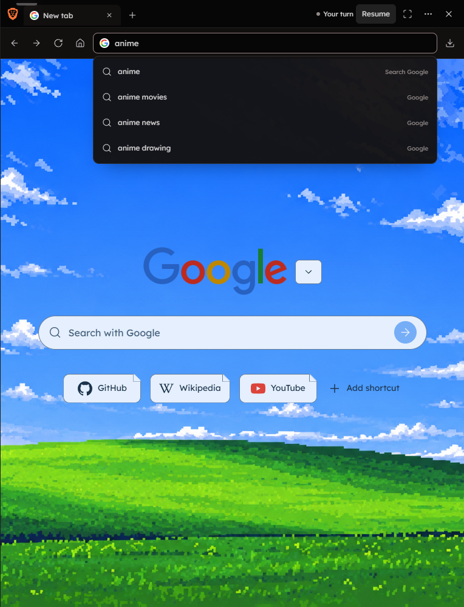

# Browser workspace, opening behavior and autocomplete

The publication checkout starts at `0693b2f` on `main` and contains only the browser patch. Ongoing YouTube creator, background-history and notification work in the original checkout is excluded.

## Behavior

- Chat and browser share one divider with aligned chat insets in either sidebar state. Approved homepage artwork remains unchanged.
- Browser visibility is an explicit session choice. Older saved layouts are masked at startup by the Workspace Layout owner; mounting the panel never launches Brave. Sidebar clicks open it explicitly. A fresh chat request can reveal a new or existing session using the typed `presentation_revision`.
- The local homepage appears immediately. New tabs focus an empty address field without showing suggestions or requesting history. Typing shows suggestions, and clearing hides them. Engine selection focuses the homepage search field with its existing draft and caret at the end.
- The panel close control and closing the only tab dismiss the panel and close the owned Brave session. Offline dismissal remains a transient override in the existing layout owner. A close before startup does not create a session; pending opening cannot override a later dismissal. Agent workflows retain a blank last tab for compatibility.
- Navigation uses cancellable background tasks. Status reads cached titles and schedules bounded background title reads rather than blocking on every tab.
- Address suggestions combine tabs, shortcuts, known websites and up to eight matches from the existing owned Chromium history. The owner caches at most 500 history rows while Windows locks that database. No second database or default-user browser profile is read.
- Public completions send only the query to the selected engine, with a persisted Search suggestions switch. Cookies, credentials and local history are not sent. Provider blocking leaves local suggestions and the Search row available; the implementation does not switch to another provider.

## Publication verification

- Exact scoped frontend: 344 tests across 37 files. The full run passed 343 tests and timed out on one control-parity test under Windows resource load. The separate 10-test parity suite passed, covering that remaining test.
- Exact scoped backend browser/MCP/capability selection: 182 passed, 6 skipped, 2773 deselected. The complete backend suite was not run for this publication.
- Production frontend build passed with existing classic-script warnings. Whitespace checks passed. UI handler fingerprints were recomputed for the scoped sources, without unrelated notification handlers.
- Earlier live Brave checks verified multiple tabs, last-tab process shutdown, a zero-width extra gutter in both sidebar states, and immediate new-tab home and focus responses of 97, 101 and 97 ms. These timings describe presentation, not website loading.
- Muted Brave fixtures verified saved-visible startup, explicit sidebar opening, typing-only suggestions, clearing, engine focus, reload hiding and fresh same-session chat presentation. This tests the UI/status boundary rather than a live LLM chat turn.
- Screenshots below were captured from the exact publication UI with fixture tabs and queries. They contain no personal history or account data.

## Limits

Google and DuckDuckGo returned live completions during implementation. Brave was rate-limited and Startpage redirected to a blocked page. SearXNG depends on the configured instance; live instance completion was not verified.

Websites retain the existing streamed Brave transport. Native WebView2 work, CAPTCHA guarantees and extended media-playback checks are outside this patch.
