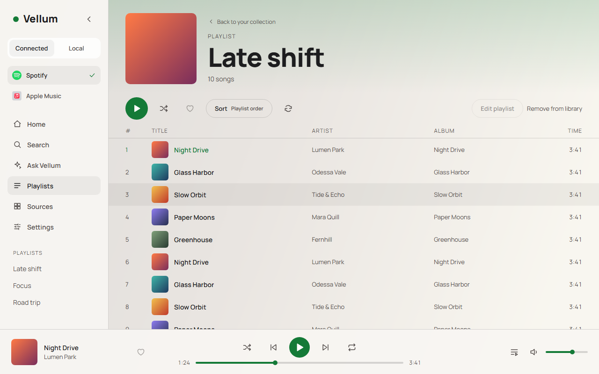
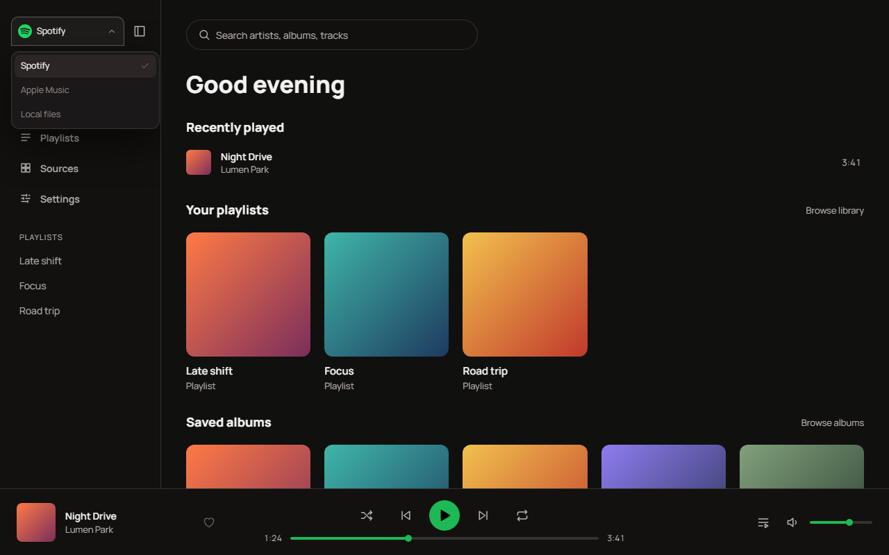
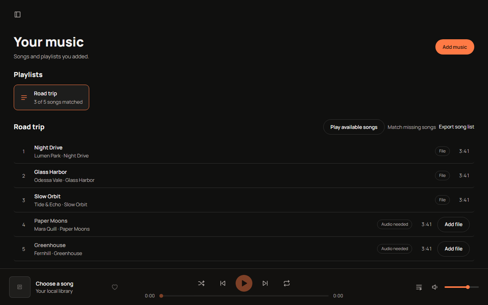
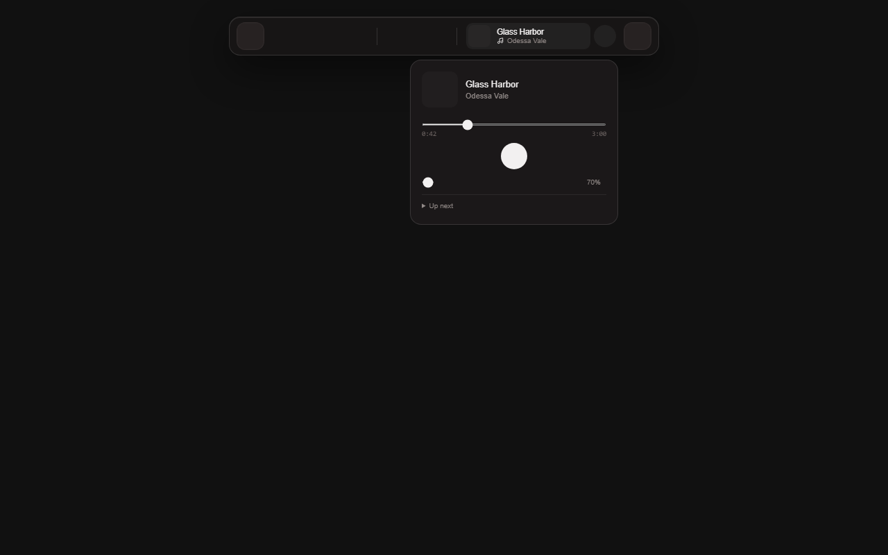
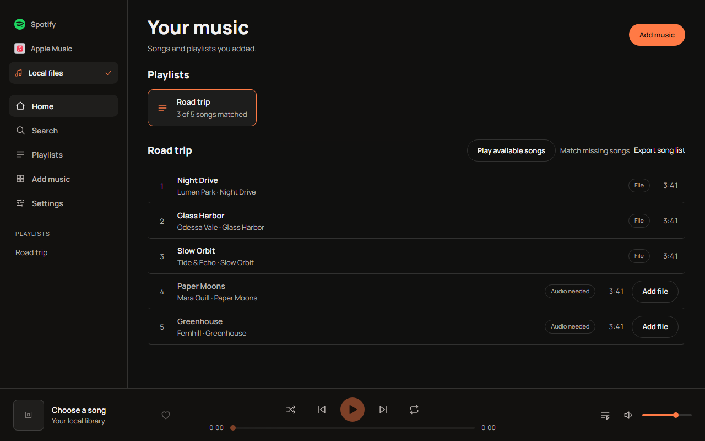
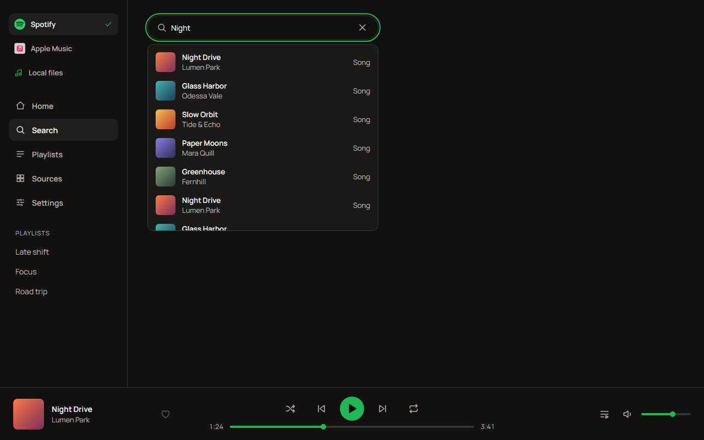

# Music and dictation draft PR — 2026-10-29

## Scope and checkpoint

The scoped branch starts from main at db399f5c4f0b287a7aee9cc1d5bdfcd1b44273e6. Music PRs #216, #219 and #225 and the original local Whisper dictation PR #226 are already merged. PR #235 covers unrelated connector cleanup; it merged while this draft was being published. Main at 618cfa2 is merged into this branch to resolve shared changelog and parity-registration conflicts. Those existing main changes are not part of this PR diff. Only Music, newer dictation worker/audio fixes and the catalog-loading dependency are projected from the shared checkout. Unrelated work remains in that checkout.

## Verification boundary

No tests, builds, provider integration checks or audible playback checks were run for this publication, as requested. Source/diff review, explicit file selection and scoped handler-fingerprint generation are publication bookkeeping, not a passing runtime test. Existing regression suites are included for review and CI. Historical test totals from the broader shared checkout are not proof of this isolated projection.

The screenshots below were captured earlier with synthetic music data in headless fixtures. They illustrate the prior implementation and do not represent a fresh render of this PR branch or attended native/long-session playback.

## Hosted CI repair — 2026-10-30

The first hosted run at 2e9165d failed two backend checks (3,793 passed, 28 skipped) and one frontend assertion (715 passed); its production build, dependency audits/review and secret scan passed. The subprocess intentionally supplies only backend on PYTHONPATH, exposing a repository-root import in the new public metadata path. Spotify metadata now loads through the existing portable-plugin runtime, shared by API and local imports. The action-set assertion now includes spotify.playlists.link, and the bridge assertion permits the intentional script cache version.

CodeQL reported an HTML-extraction regex and a whitespace-led unanchored local-command suffix regex. Apple data scripts now use HTMLParser, supporting HTML tag/attribute case and quote variants. Local commands scan non-whitespace tokens once and inspect the suffix, preserving the original song-title slice. Regression cases cover actual Apple import reads, title spacing, explicit local transport and long whitespace inputs. No CodeQL rules, severities or workflow checks were disabled. No local tests or builds were run for the repair; hosted validation results are recorded separately after publication.

## Design and limitations

Music retains the existing Spotify SDK owner and uses one persistent local audio singleton; neither sidebar navigation nor the Island creates a second player. Typed App Actions retain mutation ownership. Local audio and derived artwork stay in the canonical local library; no auth stores, music files, recordings, model weights or databases are committed. The action catalog uses PluginRegistry.read_snapshot per response and keeps next-request enablement refresh.

Apple streaming, service transfers, lyrics services, crossfade and gapless playback remain unavailable. Spotify/Apple links import song-list metadata rather than exporting protected subscription audio. Optional YouTube discovery/acquisition backend code uses explicit source selection and permission acknowledgement; those acquisition controls are not exposed by the redesigned UI. Public Spotify metadata may be incomplete, unavailable or stale; source positions and unknown completeness remain explicit in the contract.

Whisper changes handle malformed/truncated WAV files and give the dictation worker its own parent-exit helper and optional CUDA directory. The already-merged dictation preferences, recording history and composer UI remain in the base. Conversational voice is outside this PR.

