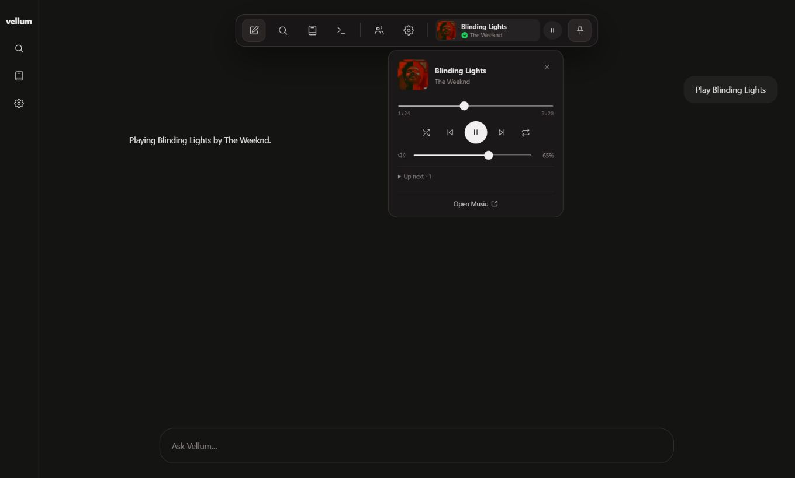

# Dock music player verification

The compact music player previously floated separately from the navigation dock.
This change places its cover, title, artist and Play/Pause inside the dock, with
expanded controls anchored inward for each dock position. GlobalDock owns
temporary visibility; SpotifyPlayer retains the canonical playback controller,
snapshot, polling and Music-page portal. Playback/session App Action adapters are
unchanged.

Legacy Music and Browser stylesheet rules are removed. The Music rule previously
applied an 88-pixel bottom offset to the newly inline player, moving it out of the
visible dock while leaving its layout space behind. A regression test loads the
served external styles and detects that displacement.

## Isolated branch checks

Verified on current main (`8321d7f`) with only the dock patch applied:

- Full frontend suite: **364 passed in 39 files**. This includes 17 player tests
  covering containment, transport dispatch, outside dismissal, keyboard focus,
  all four dock positions, disconnection, stale snapshots and retained-controller
  navigation. Vite routing tests ran outside the Windows sandbox because its
  loopback restrictions otherwise prevent the fixture server from being reached.
- Backend UI, Music-surface and visual-action contract checks: **29 passed**.
- API capability check: **1 passed**, 94 unrelated tests deselected.
- Production Vite build, reviewed handler inventory and `git diff --check` passed.
  Existing classic-script build warnings remain.

The primary development checkout also received browser inspection with the real
frontend and connected playback metadata. Its player was observed inside the dock
and the expanded controls fit at a 320-pixel viewport. A disposable fixture using
the real dock/player components and complete Music/Browser stylesheet stack
verified top, bottom, left and right layouts. That fixture used synthetic state,
performed no Spotify requests and produced no audio.

The sample below uses synthetic music state rather than private account history.
It shows the implemented controls, not a generated design render.

## Limits

Live Spotify audio was not retested for this layout change. Controller retention
and transport behavior passed automated tests, but these checks do not establish
uninterrupted playback over days or months. Full backend-suite verification is
left to CI. Pending voice, browser-settings, YouTube and other local work is
excluded from this publication.
