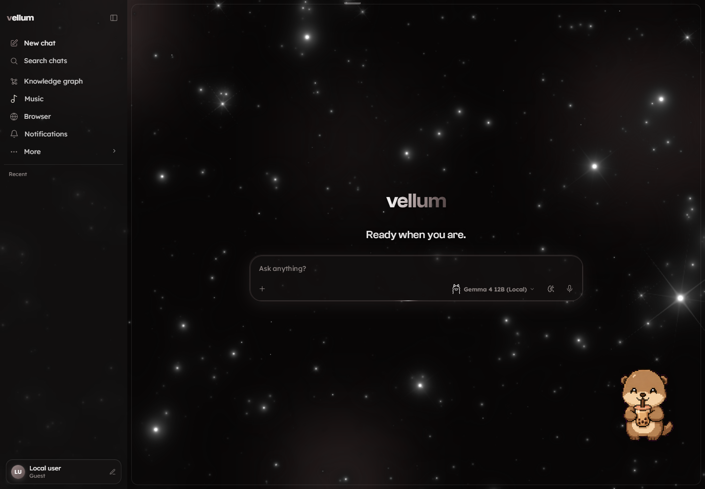

# Chat-scoped interface publication — October 31, 2026

## Scope and base

This branch publishes only the changes requested in the current Vellum chat: source-scoped model selection and provider configuration; Settings/navigation cleanup; thinking orbs, streamed answers and event-driven tool/source activity; startup and message following; inset off-canvas sidebars; the supplied composer menus and selective morphing tooltips; Music sidebar/background cleanup; and the approved whole-app Unslop pass, including the retained landing animation/glow and profile-hover dismissal fix.

It is stacked on draft PR #236, `codex/music-dictation-workspace` at `6207e20`, which already incorporates main at `19a30f2`. That existing PR owns the earlier Music/local-playback and dictation implementation. This branch adds only the current chat's Music presentation changes. Retarget this PR to main after #236 lands. The 15 supplied DVK backgrounds are already on main through #234 and are not duplicated here.

The shared development checkout contains other chats' work. Publication was prepared in an isolated worktree with an explicit file manifest. Unrelated voice-session/speech changes, collapsed-transcript presentation, connector work, calendar/time changes, YouTube changes, local databases, keys, logs, caches and skill state are excluded. Existing main fixes and the original checkout are preserved.

## Important behavior and boundaries

- The model picker distinguishes API source from model vendor. Local exposes Gemma 4 12B through Ollama; OpenRouter/OpenAI expose their existing reviewed catalogs. The picker can switch connected sources through existing settings/conversation actions. Configuration can save additional providers' credentials through the existing confirmation flow, but does not add inference adapters for those providers.
- Archive and Analytics move into Settings. Skills management remains under Settings > Plugins; the standalone Skills route and sidebar action are removed. Compatibility navigation retains existing actions and services.
- Progress follows observed delegations, tool execution and returned sources. Page-reading labels require extraction results. Internal preparation/compaction and specialist structured output are excluded from the visible answer. Errors preserve provider context and partial output. Successful identical reads may be reused within a turn; writes and unknown/mixed batches retain execution/confirmation ownership.
- Startup requests conversation summaries and hydrates selected chats through existing open/deep-link paths. Reload starts at home. Automatic compaction remains extractive; semantic summarization is manual-only.
- Books can use the selected cloud route without the Books-only local-model restriction. Normal disclosure, protected identifiers, approved model routing and Book claim validation remain in effect.
- Shared menu motion and tooltips are opt-in. Landing text motion and the curved glowing input are retained by explicit request. Supplied backgrounds, orbs and Books scene source are preserved. Unslop guidance is credited in DESIGN.md and the implementation notes to Damir Sokolovsky, CC BY 4.0.

## Verification

No tests or builds were run for this publication, as requested.

Publication checks: changed Python sources parsed with AST; changed inline JSX, JavaScript and JSX parsed with Babel; changed CSS parsed with PostCSS. The entry's local head assets exist in the isolated checkout. Lexical comparison found only the new browser globals `matchMedia` and `MutationObserver`, with no unresolved application helper. API global-reference comparison found no new unresolved names. The staged whitespace check passed.

The original checkout's earlier read-only API measurements, isolated browser/SSE replay and desktop/mobile inspections are recorded in the accompanying dated verification notes. Those are historical evidence from this chat, not a fresh live run of the isolated PR. No private Book-content cloud request, cloud completion, audible playback, import/write flow or packaged desktop verification was performed for publication. Latency measurements are observations, not guarantees.

### Action Parity reconciliation

The publication base's source fingerprints matched its inventory before applying this chat's changes. This avoids carrying the development checkout's pre-existing inventory drift into the PR. Main's reviewed bindings change while its count remains 932: provider/effort and Configuration callbacks use existing actions, Archive/Analytics callbacks move into Settings, removed Skills/Feed controls disappear, and menu/sidebar/tooltip/focus behavior is presentation only. Music changes from 105 to 107, Plugins from 129 to 130, and Browser settings retains 68 with native Choice replaced by canonical VSelect. VSelect remains unchanged at 5.

Registered new Settings Overview (17), response rendering (14), streaming settings/text (8), morphic UI (6), supplied thinking orbs (0) and progress projection (0). Reviewed changed locks and the sidebar pin/reopen probe were updated; unchanged sources retain their locks. The scanner recognizes the new createElement handlers and strips cache queries when resolving served React sources. This is a scoped source/inventory review, not a passing full Action Parity test-suite claim.

The earlier local notes describe unresolved drift and unpublished state at their respective checkpoints. This publication record supersedes those statements only for the isolated branch described above.

## Screenshot

The image is an earlier capture from this chat's running development UI, with isolated guest presentation and no chat messages. It illustrates the retained landing signature; it is not a new render of the isolated branch.

